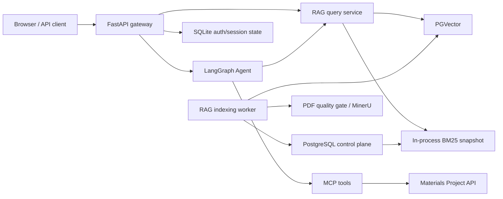

# Architecture

Agent Material `v0.1` is a single-tenant, single-API-process Agentic RAG
application. PostgreSQL is the source of truth for RAG control-plane state and
PGVector data. SQLite remains a local persistence option for authentication,
conversation sessions, and development checkpointers.

## Offline indexing invariants

- Every write enters through `RagIndexingService`; direct PGVector chunk writes
  are rejected.
- A document version is invisible during staging and becomes queryable only
  after validation and a transactional active-version switch.
- Task ownership is guarded by a lease and monotonically changing fencing
  generation. A worker that loses its lease must not commit activation.
- The parent and child records used by retrieval must share document and
  version identity.
- A failed parse, embedding batch, validation, or activation leaves the prior
  active version available.
- BM25 publishes a fully built immutable snapshot only after its captured
  PostgreSQL revision is still valid.

## Online retrieval invariants

- Query rewriting is request-scoped; HyDE output and rewritten queries are not
  stored in shared mutable state.
- Vector and lexical candidates are filtered against active version identity
  before fusion.
- Reranking uses the original user question and is executed at most once for
  the globally fused candidate set.
- Parent lookup includes `(parent_id, document_id, version_id)` and preserves
  reranked order.
- The citation list and generation prompt are derived from one frozen request
  context so they cannot silently diverge.

## Authorization boundary

The initial release has one shared knowledge base. Administrators manage files,
indexing tasks, retries, consistency checks, and MCP configuration. Authenticated
non-admin users query the shared knowledge base. This is not document-level or
tenant-level access control.

## Process boundary

SSE replay buffers, BM25 snapshots, lazy service singletons, and some caches are
process-local. Run one API worker. A future multi-replica version requires a
shared event store/cache and explicit distributed invalidation.

## Failure and degradation

- RAG startup failure is logged and leaves non-RAG gateway features available.
- External reranking may fall back only when the configured fallback dependency
  is installed and policy allows it.
- Scanned/mixed/unknown PDFs fail closed if the OCR-capable MinerU route is not
  available; they must not silently enter the index as empty text.
- External model or parsing errors must be logged with internal context while
  public API responses remain generic.
