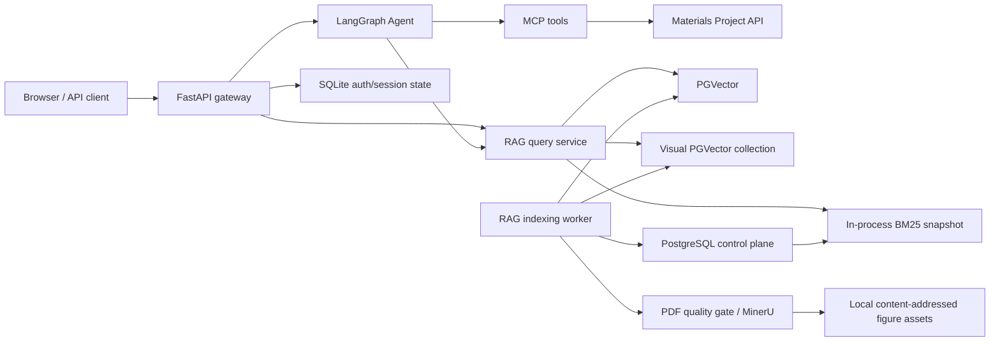

# Architecture

Agent Material `v0.1` is a single-tenant, single-API-process Agentic RAG
application. PostgreSQL is the source of truth for RAG control-plane state and
PGVector data. SQLite remains a local persistence option for authentication,
conversation sessions, and development checkpointers.

## Offline indexing invariants

- Every write enters through `RagIndexingService`; direct PGVector chunk writes
  are rejected.
- A document version is invisible during staging and becomes queryable only
  after validation and a transactional active-version switch.
- Task ownership is guarded by a lease and monotonically changing fencing
  generation. A worker that loses its lease must not commit activation.
- The parent and child records used by retrieval must share document and
  version identity.
- MinerU figure/table objects have deterministic `artifact_id` values. Their
  PostgreSQL records and vector representations participate in the same
  staging/active/retired transaction as the containing document version.
- Binary figure assets are stored outside PGVector under content-addressed
  local paths. Metadata exposes only `rag-asset://` logical URIs.
- A failed parse, embedding batch, validation, or activation leaves the prior
  active version available.
- BM25 publishes a fully built immutable snapshot only after its captured
  PostgreSQL revision is still valid.

## Online retrieval invariants

- Query rewriting is request-scoped; HyDE output and rewritten queries are not
  stored in shared mutable state.
- Vector and lexical candidates are filtered against active version identity
  before fusion.
- Reranking uses the original user question and is executed at most once for
  the globally fused candidate set.
- Parent lookup includes `(parent_id, document_id, version_id)` and preserves
  reranked order.
- The citation list and generation prompt are derived from one frozen request
  context so they cannot silently diverge.
- Figure/table candidates are deduplicated by `artifact_id`; returned sources
  preserve the object type, caption, page/bounding box, and logical asset URI.
- P2 visual queries use a deterministic, model-free route planner. Plain text
  questions do not call the image embedding provider; figure, panel, trend,
  comparison, and numeric-chart questions may enable the visual channel.
- Text-vector, BM25, and image-vector rankings are fused with weighted RRF.
  Main-image and panel duplicates of one artifact contribute only once per
  channel, while the best matched panel location is retained as evidence.
- REST search, Agent tools, and answer generation expose the same versioned
  `evidence_locator`: document/version identity, page, artifact/panel, bounding
  box, logical asset URI, retrieval channels, and numeric fact-gate state.

P1 adds an opt-in visual description stage for figures. The structured JSON and
its deterministic text representation are stored with the same document
version and reused by the existing hybrid retriever. When separately enabled,
online generation sends only the frozen top visual evidence to a visual model;
timeouts or model errors fall back to the frozen text RAG context. Both visual
features are disabled by default.

P2 adds a separate PGVector collection for high-resolution figure and explicit
panel embeddings. Text queries and image assets are embedded by the same
multimodal model and dimension. Visual vectors share the document lifecycle:
they are written as staging records, validated by exact expected count, and
activated/retired in the same control-plane transaction as text vectors. The
provider call receives image bytes as a data URI; neither the payload nor stored
metadata contains a host path. The feature remains default-off and requires
explicit external-processing consent, credentials, reindexing, and evaluation.

P2 intentionally does not perform automatic chart digitization or unrestricted
automatic panel detection. Those features have a higher silent-error risk and
remain outside the stable-delivery scope.

Before visual description, low-resolution MinerU figures are re-rendered from
the original PDF using the page number and MinerU's normalized bounding box.
Rendering starts at 300 DPI and may increase to a bounded 450 DPI to meet the
configured readability target. Derived images remain content-addressed assets.
Panel crops require explicit pixel boxes by default; whitespace-based automatic
splitting is available only as an opt-in mode because axes and legends can look
like panel gutters.

Visual JSON validity is separate from factual validity. A conservative fact
gate always stores the raw model result for auditing, but excludes unverified
multi-series trends and numeric key values from trusted retrieval text. Model
confidence and model self-verification are not trusted. Exact values are
released only when legend mapping and numeric facts are confirmed by a human,
gold evaluation, or a trusted parser. Numeric questions over blocked evidence
return a controlled response without another visual-model call.

Authenticated clients can preview an active figure through its opaque
`artifact_id`. The gateway resolves the logical URI server-side, rejects path
traversal and unsafe media types, and never returns a host filesystem path.

## Authorization boundary

The initial release has one shared knowledge base. Administrators manage files,
indexing tasks, retries, consistency checks, and MCP configuration. Authenticated
non-admin users query the shared knowledge base. This is not document-level or
tenant-level access control.

## Process boundary

SSE replay buffers, BM25 snapshots, lazy service singletons, and some caches are
process-local. Run one API worker. A future multi-replica version requires a
shared event store/cache and explicit distributed invalidation.

## Failure and degradation

- RAG startup failure is logged and leaves non-RAG gateway features available.
- External reranking may fall back only when the configured fallback dependency
  is installed and policy allows it.
- Scanned/mixed/unknown PDFs fail closed if the OCR-capable MinerU route is not
  available; they must not silently enter the index as empty text.
- External model or parsing errors must be logged with internal context while
  public API responses remain generic.
