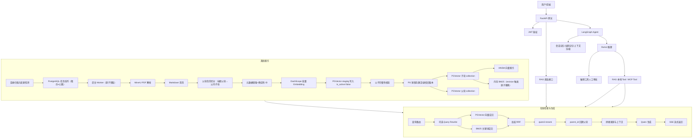

# 27 届秋招 Agent 应用开发面试手册

> 项目：面向材料科学的 RAG 知识库问答系统  
> 目标岗位：Agent 应用开发 / RAG 应用开发 / 大模型应用开发  
> 依据：当前仓库代码、配置、评测结果，以及简历中的项目描述

## 一、先给结论：这个项目适不适合拿来秋招

适合。它不只是一个“上传 PDF + 向量检索 + 调 LLM”的 Demo，而是已经覆盖了 Agent 应用开发岗位常问的四类能力：

1. **RAG 算法链路**：解析、清洗、切分、Embedding、混合召回、Query Rewrite、Rerank、父子块回溯、引用生成。
2. **Agent 集成**：RAG 被封装为 LangChain Tool，接入 LangGraph ReAct Agent；同时支持本地进程调用和 MCP 工具生态。
3. **工程化**：FastAPI、JWT、SSE、后台任务队列、增量文件扫描、PGVector、Docker、日志和指标监控。
4. **评测闭环**：项目中已有 40 条 RAGAS 评测记录和 chunk 质量评估工具。

以下问题经 P0 稳定性改造（见 `specs/rag-p0-stability-hardening-spec.md`）后的最新状态：

- 多查询检索仍为顺序执行（有意为之，保证确定性与可解释性），简历统一表述为"多路检索"，不写"并行检索"。
- ~~不同改写查询之间没有跨查询 RRF、没有全局 Rerank~~ **已修复**：跨查询 weighted RRF + 原始 query 全局 Rerank（每请求恰好一次）。
- 查询路由会输出 `factual / summary / comparison`，但该类型当前没有真正参与后续策略选择（仅记录用于评测，属有意收敛）；配置中所说的 `auto` 自适应策略没有完整落地。
- BM25 是从 PGVector 加载 active 子块后在内存中构建的，不是 PostgreSQL 内的持久化倒排索引，也不是 Elasticsearch；新版本激活后原子替换刷新，无需重启。
- MinerU 提取了结构化 Markdown，但当前没有图像向量模型；不要把它描述成"多模态图像检索"。
- ~~README 仍写 ChromaDB~~ **已修复**：README 已更新为 PGVector 实际架构。
- ~~没有消融对比~~ **已建设**：60+ 条固定评测集与 6 配置消融运行器（`evaluation_data/fixed_eval_dataset.json`、`scripts/run_ablation.py`），引用提升幅度时以消融报告为准。

## 二、面试开场：1 分钟项目介绍

可以直接这样回答：

> 我做的是一个面向材料科学文献的 RAG 问答系统，主要解决材料论文中专业术语密集、公式和表格多，以及普通向量检索容易出现关键词漏召回和上下文不完整的问题。系统分为离线索引和在线检索两条链路。离线阶段先用 MinerU 将 PDF 解析为结构化 Markdown，对出版商导航、目录、特殊字符和 LaTeX 格式做清洗，然后经过标题切分、递归切分、相邻块语义合并和父子块构建，补充来源、DOI、语言、内容类型等元数据。最终使用 text-embedding-v4 生成 1024 维向量，在 PGVector 中分别存储父块和子块，并建立 HNSW 索引；子块同时用于构建 BM25 检索器。在线阶段先用结构化输出做闲聊、无关问题和问题类型路由，可选执行 Expand、HyDE、Step-back 和 Decompose 四类查询改写；单路检索内部使用向量召回和 BM25 的加权 RRF 融合，再通过 qwen3-rerank 精排，最后根据 parent_id 回溯父块，作为上下文交给大模型生成带来源标记的回答。系统通过 FastAPI 和 SSE 对外提供服务，并把 RAG 封装成 Agent Tool 接入 LangGraph。项目还建立了 40 条 RAGAS 评测基线，目前 faithfulness 为 0.9347、context recall 为 0.8875，但 context precision 只有 0.2831，说明召回覆盖较好，下一阶段重点是优化跨查询融合和精排。

这段介绍的优点是：讲清了业务难点、两条主链路、关键技术选择、Agent 集成方式和真实评测结果，同时没有夸大当前实现。

## 三、项目完整架构与请求流程

### 3.1 系统总流程

1. 用户可以直接调用 `/api/v1/rag/search` 或 `/api/v1/rag/query`，也可以进入 Agent 对话。
2. Agent 模式下，LangGraph 执行“记忆召回 → 必要时压缩 → LLM 决策 → 工具调用/人工审批 → 最终回答”的状态机。
3. 当 Agent 判断需要查知识库时，调用进程内 `rag_search` 或 `rag_query` Tool，避免本地 RAG 再走一次 MCP JSON-RPC 和子进程通信。
4. 离线索引由文件扫描触发，任务进入 PostgreSQL 持久化队列，Worker 原子领取（行锁 + 租约 + 心跳）后完成解析、父块优先切分、Embedding、staging 写入和事务激活。
5. 在线阶段先判断是否闲聊或无关问题；正常材料问题进入混合检索、重排、父块回溯和生成链路。
6. FastAPI 使用 SSE 发送状态、来源、token、完成或错误事件；Agent 对话还支持 HITL 和断流续传。

## 四、RAG 离线索引：逐阶段深挖

### 4.1 文件发现与增量检测

- 文件状态保存在 PostgreSQL `rag_file_states`（路径、内容 hash、mtime、size、激活版本、索引时间）。
- 快速路径先比较 mtime 和 size，未变化时不再计算内容 hash；变化后才用 hash 确认内容是否真的改变。
- 扫描只创建任务：新增、修改和删除任务进入 PostgreSQL 持久化队列（`rag_ingest_tasks`，dedup_key 防重复入队），Worker 用 `SELECT ... FOR UPDATE SKIP LOCKED` 原子领取，处理期间心跳续约，崩溃后租约过期任务自动回收重试。
- 文件状态只在版本激活事务成功后才更新；扫描不提前标记任何状态。

为什么这样设计：PDF 解析和 Embedding 都是慢操作，把它们移出请求线程，管理页面可以快速返回，服务也不会因为批量入库而长时间阻塞。控制面（任务/文件/版本状态）与 PGVector 数据同在 PostgreSQL，激活用短事务保证一致，消除了 SQLite + PG 双库的一致性窗口。

### 4.2 MinerU PDF 解析

- 小于等于 20 页的 PDF 直接调用 MinerU Flash。
- 大于 20 页的 PDF 先按页范围切成多个临时 PDF，再用 `ThreadPoolExecutor(max_workers=3)` 并发解析，最后按页码排序合并。
- 单个切片支持指数退避重试，失败片段会留下标记，便于定位缺页。
- MinerU 不可用、解析失败或清洗结果为空时，回退到 PyMuPDF/PyPDFLoader 纯文本提取。

选择 MinerU 的原因：材料论文中公式、表格、标题层级和多栏排版很多，普通 PDF 文本抽取容易打乱阅读顺序；MinerU 输出 Markdown 后，下游可以利用标题和表格结构进行切分。

必须准确表述：当前是“结构感知的文本 RAG”，不是图像向量检索。图像主要保留为 Markdown 占位或附近文本，未使用 CLIP、多模态 Embedding 或视觉 Reranker。

### 4.3 文本清洗

清洗器主要处理：

- MinerU 分段标记；
- 图片占位符规范化；
- AIP、ACS 等出版平台的推荐阅读、导航和版权噪声；
- DOI、URL、投稿信息等页眉页脚噪声；
- 目录点线和页码；
- 标题层级跳跃；
- LaTeX 命令与花括号之间的异常空格；
- 多余空行、Unicode 空白、零宽字符和控制字符。

为什么清洗重要：噪声会同时污染 Embedding 和 BM25。对向量检索而言，重复导航文本会让无关 chunk 聚集；对 BM25 而言，高频模板词会抬高错误文档的关键词得分。

### 4.4 链式切分

PDF 当前配置为：

`markdown_header → recursive → semantic_merge → parent`

关键机制：

1. `MarkdownHeaderSplitter` 按 H1-H4 标题切分，并对过长标题块继续递归切分。
2. `RecursiveSplitter` 以 500 字符、70 字符 overlap 为主配置，按段落、句号、空格等多级分隔符递归切分。
3. 切分前把代码块和 `$...$`、`$$...$$`、`\(...\)`、`\[...\]` 公式替换成占位符，切完再还原，降低公式被截断的概率。
4. `SemanticMergeOnly` 对相邻 chunk 做 Embedding 相似度判断，相似度超过 0.9 时合并；合并向量使用长度加权近似，避免每次合并都重新请求 Embedding。
5. `ParentDocumentSplitter` 生成约 2000 字符父块和约 500 字符子块；子块携带稳定的 `parent_id` 和临时 `parent_doc`。

当前风险：`parent` 位于链路末尾，而前面已经将文本切成较小块，因此部分“父块”可能并没有达到真正的 2000 字符上下文。面试时可以说这是当前版本的可优化点：先按章节构造父块，再在每个父块内部切子块，父子关系会更自然。

### 4.5 元数据增强

每个 chunk 会补充：

- `source_file / source_filename / source_ext / source_hash`；
- `source_doi / source_year / source_type`；
- `char_count / token_estimate / language`；
- `content_type`，如 paragraph、table、code、heading、figure；
- `chunk_index / total_chunks / heading_context`；
- `parent_id / chunk_type`。

作用：支持溯源引用、按来源删除、后续过滤检索、调试坏 chunk，以及父子块映射。

当前代码中 `source_year` 的正则捕获组只会返回 `19` 或 `20`，这是一个应在面试前修复的小 bug；否则不要主动宣称年份过滤已经可生产使用。

### 4.6 Embedding 与批处理

- 模型：DashScope `text-embedding-v4`，维度固定为 1024。
- 一批最多 10 条文本，最多 4 个请求并发。
- 请求失败支持指数退避重试。
- 同步接口用 `asyncio.run` 兼容 LangChain PGVector，同时在已有事件循环时通过单独线程执行。
- 父块和子块先合并为一次大批量 Embedding，再拆分后分别写入两个 collection，减少重复 API 调用。

当前风险：

- `rate_limit` 计算出了请求间隔，但实际请求路径没有使用该间隔。
- 每个批次都新建 `aiohttp.ClientSession`，连接无法复用。
- 同步 `embed_query()` 实际调用了 document 类型的 Embedding 路径，没有使用已经实现的 `aembed_query(text_type="query")`。

### 4.7 PGVector、父子 collection 与 HNSW

- `agent_small` 存子块，用于高精度检索。
- `agent_large` 存父块，用于最终上下文补全。
- 元数据存 PostgreSQL JSONB，便于按 source、parent_id 等字段查询。
- 向量列建立 HNSW 索引；配置为 `m=16`、`ef_construction=64`。
- 如果向量列没有显式维度，代码会从已有数据推断维度并执行 `ALTER COLUMN TYPE vector(N)`。
- 建索引失败不会阻断服务，会回退到顺序扫描。

HNSW 与 IVFFlat 的回答重点：HNSW 通常召回率高、查询快、无需训练，但构建更慢且占内存更多；IVFFlat 构建和内存成本更低，但依赖 lists/probes 参数和数据规模，数据量小或训练不足时召回率容易波动。本项目默认 HNSW 更适合持续增量的小中型论文库。

配置中有 `ef_search=40`，但当前代码没有在查询连接上执行 `SET hnsw.ef_search`，因此不要说这个查询参数已经生效。

### 4.8 BM25 索引

BM25 的来源是 `agent_small` collection：服务初始化检索器时，将所有子块从 PGVector 读入内存，通过 LangChain `BM25Retriever.from_documents()` 构建倒排检索器。

优点：实现简单，能补足材料名、化学式、模型名、软件参数等精确词匹配。

局限：每个进程各自保存一份，启动和热更新要重建；文档量大时内存和启动时间不可控；多实例间索引版本可能不一致。生产化可改为 PostgreSQL Full Text Search、OpenSearch/Elasticsearch，或者使用支持稀疏向量的统一检索引擎。

## 五、RAG 在线检索：逐阶段深挖

### 5.1 查询路由

`QueryRouter` 使用 Pydantic 结构化输出得到：

- 是否闲聊；
- 是否与材料知识库无关；
- 问题类型：factual、summary、comparison、unknown；
- 置信度和原因。

高置信度闲聊直接由 LLM 回答，高置信度无关问题直接拒答，分类失败则降级到正常 RAG，保证可用性。

当前问题：问题类型只被记录，没有真正决定 top_k、改写策略或生成 Prompt。因此更准确的说法是“实现了查询路由与类型标注”，而不是“已经完成按意图自适应检索”。

### 5.2 四类 Query Rewrite

1. **Expand**：生成同义词、近义词和专业术语变体，适合用户表达和论文用词不一致的情况。
2. **HyDE**：先生成一段假设答案，对假设文档做 Embedding；向量路使用该向量，BM25 和 Rerank 仍使用原始 query。
3. **Step-back**：把具体问题抽象成更通用的原理问题，原问题和抽象问题分别检索。
4. **Decompose**：把多跳或对比问题拆成可独立检索的子问题。

默认策略是 `step_back+expand`。按配置，原始问题先扩为“原问题 + 退一步问题”，然后每个问题再扩出多个变体。

当前实现通过顺序循环逐个调用 LLM 和 Retriever，不是真并发。要兑现简历中的“并行检索”，应使用异步 Retriever 和 `asyncio.gather`，并对总并发、超时、失败降级和成本设置边界。

### 5.3 单路混合召回

单个查询内部的检索链为：

1. PGVector 向量召回 top 10；
2. 将 cosine distance 归一化为 `[0,1]` 分数：`normalized_similarity = 1 - distance / 2`；
3. 按 0.5 阈值过滤，如果全被过滤则保底返回 Top-1；
4. BM25 关键词召回 top 10；
5. `EnsembleRetriever` 对两路排名做加权 RRF，当前权重各 0.5；
6. 截断到最多 10 条候选，进入 Reranker。

注意：`1 - distance / 2` 是把原始 cosine similarity 从 `[-1,1]` 映射到 `[0,1]` 后的分数，不应直接称为未经归一化的 cosine similarity。

### 5.4 为什么用 RRF，而不是直接加相似度

向量距离和 BM25 分数不在同一个量纲，直接线性相加需要额外归一化，且不同查询的分布会变化。RRF 只依赖排名，形式可以表达为：

`score(d) = Σ weight_i / (c + rank_i(d))`

它对异常分数更稳健，也能奖励在多路检索中都排名靠前的文档。项目中的 `EnsembleRetriever` 用于 Vector 与 BM25 的单查询融合。

### 5.5 Rerank

- 默认调用 DashScope `qwen3-rerank`。
- 对最多 10 条候选进行 query-document 相关性打分，返回 top 3。
- 429、5xx 和网络错误会重试；最终失败则保留原始排名，避免整条 RAG 链路不可用。
- 还保留本地 HuggingFace CrossEncoder 作为可选降级路径。

为什么需要 Rerank：双塔 Embedding 适合大规模召回，但 query 和 document 独立编码，细粒度交互不足；Cross-Encoder/Reranker 联合编码 query-document，能更准确判断专业术语、条件限定和否定关系，但计算成本更高，所以只处理小规模候选集。

### 5.6 多查询结果融合的真实实现

不同改写查询分别执行完整检索链后，当前代码按照查询顺序拼接结果，用正文前 200 字符的 Python hash 去重，再截断 top 5。

这意味着：

- 不同改写查询之间没有全局 RRF；
- 最终没有基于原始 query 对合并候选再做一次全局 Rerank；
- 越早执行的查询具有顺序优势；
- Python hash 存在进程随机化和极低概率碰撞，最好换成稳定的 chunk_id。

推荐改造：每个 query 只做召回，所有候选用跨查询 RRF 或 weighted RRF 合并，再用原始 query 做一次全局 Rerank。这样更符合“多路召回 → 融合 → 精排”的标准表述。

### 5.7 父块回溯

Rerank 后从子块提取唯一 `parent_id`，再到 `agent_large` 批量查询父块，最终把父块交给 LLM。

优点：子块短，向量表达更聚焦；父块长，生成时上下文更完整，解决“检索精度和上下文完整性”的冲突。

当前风险：SQL 使用 `ANY(parent_ids)` 查询但没有显式 `ORDER BY`，数据库返回父块的顺序不保证与子块相关性顺序一致。应建立 `parent_id → rank` 映射，在应用层恢复顺序，或在 SQL 中用 `unnest(... WITH ORDINALITY)` 排序。

### 5.8 Prompt、引用和拒答

- 每个父块被格式化为 `[参考资料N] 来源：文件名 + 正文`。
- Prompt 要求只依据上下文、无资料时明确拒答、指出资料冲突并使用 `[参考资料N]` 标注。
- 检索为空时不调用 LLM，直接返回“根据现有资料无法回答”。

这属于“软约束”，并不能从机制上保证引用一定正确。更强的做法是结构化生成 citation IDs，生成后校验每个引用是否存在，并对回答中的 claim 做句级归因检查。

### 5.9 SSE 服务

- FastAPI 发送 status、start、sources、token、done、error、cancelled 等事件。
- 同步检索通过 `asyncio.to_thread` 移出事件循环。
- 同步流式生成器在线程里消费，通过 `asyncio.Queue` 桥接回异步 SSE。
- 长时间无 token 时发送 heartbeat，避免代理或浏览器误判断连。

当前 `/rag/query` 先检索一次发送 sources，之后又调用 `get_summary_stream()`，而后者会再次路由和检索，因此一次请求可能重复检索两次，且 sources 与最终生成上下文理论上可能不一致。这是面试前值得修复的工程问题。

## 六、项目中全部值得讲的技术点

| 层级 | 技术点 | 你要讲清的价值 |
|---|---|---|
| 前端/API | 原生 JS、FastAPI、Pydantic | 轻量管理页、请求校验、接口契约 |
| 认证 | JWT、bcrypt、接口级 user_id 校验 | 用户隔离与接口安全 |
| 流式协议 | SSE、heartbeat、token 序号、取消、断流续传 | 提升长任务体验和可恢复性 |
| Agent | LangGraph、ReAct、ToolNode、条件边、HITL | 显式状态机、工具循环和敏感操作审批 |
| 记忆 | SQLite 会话、PGVector 长期记忆、上下文摘要 | 多轮对话、用户知识和 token 控制 |
| 工具体系 | LangChain Tool、MCP、Materials Project | 本地低延迟能力与外部工具标准化接入 |
| 文档解析 | MinerU、pypdf、PyMuPDF/PyPDFLoader | 复杂 PDF 结构提取与降级 |
| 清洗 | 正则、Markdown 结构恢复、Unicode 规范化 | 降低 Embedding/BM25 噪声 |
| 切分 | 父块优先切分（标题父块→父内子块）、公式保护、递归切分 | 兼顾语义完整、召回粒度和生成上下文 |
| Embedding | text-embedding-v4、aiohttp、批处理、并发、重试 | 提升入库吞吐并控制失败 |
| 向量库 | PostgreSQL、PGVector、JSONB、HNSW/IVFFlat | 向量搜索、元数据过滤和持久化 |
| 关键词检索 | BM25、倒排索引、revision 触发原子替换 | 精确匹配材料名、化学式和软件参数 |
| 融合 | weighted RRF（单查询 + 跨查询两级） | 跨检索器、跨查询稳健融合 |
| 查询理解 | structured output、Expand、HyDE、Step-back、Decompose | 提升表达泛化和复杂问题召回 |
| 精排 | qwen3-rerank（每请求一次全局精排）、本地 CrossEncoder 备用 | 小候选集上提升相关性 |
| 索引控制面 | PostgreSQL 任务队列（SKIP LOCKED 原子领取、租约/心跳）、版本状态机、短事务激活 | 索引任务持久化、崩溃恢复、版本一致性 |
| 可观测性 | Prometheus、OpenTelemetry、Langfuse/LangSmith、结构化日志 | 检索耗时、文档数、LLM 调用和链路追踪 |
| 部署 | Docker Compose、Uvicorn、PostgreSQL/pgvector | 环境标准化和本地部署 |
| 评测 | RAGAS、chunk 规则评估 | 从主观效果转向可量化迭代 |

## 七、面试高频问题与参考回答

### A. 项目与方案选择

#### 1. 为什么选择 RAG，而不是微调大模型？

RAG 更适合论文知识库：文献持续新增，需要保留来源并可删除或更新；微调难以做到知识实时更新和精确溯源，也可能把错误知识固化进参数。微调更适合统一回答风格或领域表达，RAG 负责事实知识，两者不是互斥关系。

#### 2. 材料科学文献比普通知识库难在哪里？

主要有四点：PDF 多栏排版导致阅读顺序错乱；公式、表格和图注容易被普通解析器破坏；材料名、化学式和软件参数要求精确词匹配；一个结论通常依赖较长的实验条件或方法上下文。因此我分别从 MinerU 解析、公式保护、Vector+BM25 和父子块补全解决。

#### 3. 你的核心贡献是什么？

可以回答：我负责 RAG 的离线和在线主链路设计与实现，包括 MinerU 大文件解析和回退、清洗与链式切分、父子 collection、PGVector HNSW、BM25 混合召回、四类 Query Rewrite、Rerank、RAGAS 评测，以及将 RAG 封装成 Agent Tool 并通过 FastAPI/SSE 对外服务。

#### 4. 这个项目和普通 LangChain Demo 的区别是什么？

普通 Demo 往往只有 Loader、固定切分、向量库和 Prompt。本项目增加了增量任务队列、材料文献清洗、结构化切分、父子块、混合召回、Query Router、四类改写、Rerank、失败降级、SSE、Agent Tool 和离线评测，因此重点是端到端检索质量和工程可用性。

#### 5. RAG 为什么还要集成 Agent？

固定 RAG Chain 适合每个问题都必须查知识库的场景。Agent 可以根据任务决定是否调用 RAG、Materials Project 或其他工具，还能执行多步任务。项目同时保留直连 RAG 接口，避免简单问答也被迫走 Agent 推理，从而在灵活性和延迟之间平衡。

### B. 离线索引

#### 6. 为什么用 MinerU，不直接用 PyPDFLoader？

PyPDFLoader 更偏向按页抽取纯文本，处理多栏、表格和公式时结构容易丢失。MinerU 输出 Markdown，可以保留标题、表格、公式和图像位置。为了可用性，我仍保留纯文本 Loader 作为失败降级。

#### 7. 大 PDF 怎么处理？

先获取页数，超过 MinerU Flash 的 20 页限制就按 20 页切片；切片一次性生成后用 3 个线程并发调用解析服务，单片失败做指数退避，最终按起始页排序合并并清理临时文件。

#### 8. 如何避免公式被切断？

在递归切分前，用正则识别 display math、inline math、LaTeX 括号公式和代码块，把它们替换成唯一占位符；切分后再还原。这样不能保证所有不规范公式都被识别，但能显著降低常见 LaTeX 公式被截断的概率。

#### 9. 为什么不是只用语义切分？

纯语义切分成本高、边界不稳定，且公式和标题结构不一定能被 Embedding 正确表达。我先利用 Markdown 标题和字符长度获得稳定边界，再用相邻语义合并修复被机械切开的段落，兼顾成本、稳定性和语义完整。

#### 10. chunk_size=500、overlap=70 怎么来的？

这是当前经验基线，不应说成理论最优。500 字符让材料术语和局部定义比较集中，70 字符覆盖相邻边界。真正严谨的做法是基于文档长度分布和检索集，对 300/500/800 等粒度、不同 overlap 进行消融，比较 Recall@K、MRR、context precision、延迟和 token 成本。

#### 11. 语义合并阈值 0.9 有什么影响？

阈值高时只合并非常相似的相邻块，块更短、召回更精确；阈值低时更容易合并，语义更完整但可能把多个主题混在一起。它应和 Embedding 模型及文档类型一起标定，不能跨模型直接复用。

#### 12. 父子块为什么比直接检索大块好？

直接检索大块时向量被多个主题稀释；只返回小块又可能缺少实验条件或上下文。父子块让检索在小块上完成，命中后返回父块，从而把“定位精度”和“上下文完整度”解耦。

#### 13. parent_id 为什么用文本 MD5？

相同父块文本在不同进程中可以得到稳定 ID，便于映射和去重。但只用文本仍可能让不同来源的相同段落共用 ID；生产化应使用 `source_id + document_version + parent_offset/content_hash`，并建立唯一约束。

#### 14. 元数据有哪些用途？

来源字段用于引用和按 source 删除；parent_id 用于父块回溯；标题和内容类型可用于过滤或加权；语言用于选择分词和 Prompt；chunk_index 用于恢复邻接上下文；hash 和版本用于增量更新与幂等。

#### 15. 修改文件如何增量更新？

当前通过 mtime+size 快速判断，再用 MD5 确认变化并入队。需要诚实说明：现版本的修改入库还缺少完整的“旧版本原子替换”，可能重复写入；我计划用版本化索引或按 source 事务删除再插入、确定性 chunk_id 和入库后更新 FileTracker 解决。

#### 16. 为什么任务队列用 PostgreSQL，而不是 Celery/Kafka？

早期版本用 SQLite WAL 队列，后来遇到跨库一致性窗口（SQLite 说激活了、PG 没翻牌，或反过来），P0 V2 把任务、文件状态、版本状态全部收敛进 PostgreSQL：与 PGVector 数据同库，版本激活可以用一条短事务完成，Worker 用 `FOR UPDATE SKIP LOCKED` 原子领取，租约+心跳支持崩溃恢复。这是单机项目，暂不需要 Celery/Kafka；如果索引量扩大到多节点，再迁移到 Celery+Redis、RabbitMQ 或 Kafka，届时 PostgreSQL 队列的 claim 语义可以平移。

#### 17. Embedding 如何提速？

每批最多 10 条，分组并发请求，失败指数退避；父块和子块合并成一次批量 Embedding 后再分别写库。进一步可复用 HTTP Session、实现真正的令牌桶限流、按内容 hash 缓存向量，并让 PGVector 写入批量事务化。

#### 18. HNSW 参数怎么理解？

`m` 控制每个节点的连接数，增大会提高召回但增加内存和构建时间；`ef_construction` 控制建图搜索深度，越高图质量越好但构建更慢；`ef_search` 控制查询搜索宽度，越高召回越好但延迟更高。当前建图参数已配置，查询端 ef_search 还需显式设置后才能生效。

### C. 在线检索

#### 19. 为什么 Vector 和 BM25 都要用？

Vector 擅长语义泛化，例如用户说“热输运”也能找到“thermal conductivity”；BM25 擅长精确字符串，例如 `LiFePO4`、`out_dos`、模型名和命令行参数。材料领域两类查询都很多，混合召回比单路更稳。

#### 20. 为什么用 RRF？

BM25 和向量距离量纲不同，直接加分数容易受归一化影响。RRF 只使用排名，对分数分布更稳健，并能奖励在多路都靠前的文档。权重用来表达不同检索器的重要性。

#### 21. 0.5/0.5 权重怎么确定？

当前是中性基线，不是最终最优。应该在带标准答案和相关文档标注的数据集上网格搜索，例如 dense:BM25 为 0.7:0.3、0.5:0.5、0.3:0.7，比较 Recall@K、MRR、nDCG 和 context precision；还可按查询类型动态调权，化学式和软件参数查询提高 BM25 权重。

#### 22. 向量阈值过滤为什么还要保底 Top-1？

阈值用于减少明显无关上下文，但阈值会受模型和数据分布影响，过严可能导致完全空召回。Top-1 保底提高可用性，但会引入错误上下文风险；更好的策略是结合绝对阈值、top1-top2 margin 和 rerank 分数决定是否拒答。

#### 23. Reranker 和 Embedding 模型有什么区别？

Embedding 是双塔结构，query 和文档可预计算，适合大规模召回；Reranker 通常联合编码 query-document，计算更慢但相关性判断更细。因此使用 Embedding/BM25 召回 top 10，再让 Reranker 返回 top 3。

#### 24. 为什么选择 qwen3-rerank API，而不是本地 BGE？

API 模式避免加载 PyTorch 和大模型，降低内存、冷启动和部署复杂度，更适合资源有限的应用服务；缺点是网络延迟、费用和外部依赖。项目保留本地 CrossEncoder 路径作为可选方案，并在 API 失败时退回原排序。

#### 25. 四种改写策略各适合什么问题？

Expand 适合术语表达不一致；HyDE 适合短问题和 query-document 表达空间差异；Step-back 适合具体问题缺少背景召回；Decompose 适合多跳、对比或包含多个条件的问题。简单事实问题不应默认叠加所有策略，否则延迟和噪声都会上升。

#### 26. 为什么默认用 Step-back + Expand？

材料问题常包含具体材料、计算条件和方法名。Step-back 补充背景原理，Expand 补充专业同义词，二者覆盖面互补。缺点是查询数量膨胀，因此应设置最大查询数并在低复杂度问题上跳过。

#### 27. HyDE 会不会把错误假设带进检索？

会。HyDE 不是把假设答案当事实，而是把它当检索向量。如果假设偏离原问题，可能造成 query drift。因此项目仍让 BM25 和 Rerank 使用原始 query，并默认关闭 HyDE；生产中还可以比较原 query 与 HyDE 向量相似度，偏差过大时禁用。

#### 28. Query Router 失败怎么办？

路由是优化层，不应成为单点故障。结构化输出解析或模型调用失败时记录 warning，然后回退到正常 RAG，保证用户仍能得到结果。

#### 29. 你实现了真正的并行检索吗？

诚实回答：没有，且这是有意的设计决策。多查询按确定顺序执行（原始 query → Step-back → Expand），保证结果可复现、可解释；简历统一使用"多路检索"。真正并行需要异步 Retriever、`asyncio.gather`、并发限流、超时、部分失败容忍和结果确定性，已列入后续 Spec。

#### 30. 多查询结果是怎么融合的？

单查询内部对 Vector+BM25 做加权 RRF；跨查询再做一次 weighted RRF（权重：原始 1.0 / Step-back 0.8 / Expand 0.7），按稳定 chunk_id 去重并累加排名贡献，消除查询顺序偏置；最后基于原始 query 做一次全局 Rerank（每请求恰好一次，失败回退 RRF 排名）。

#### 31. 如何去重？

当前用正文前 200 字符的 hash 去重，简单但不够稳定。生产化应使用入库阶段生成的确定性 chunk_id；对近重复文档还可以用 SimHash/MinHash 或 Embedding 相似度聚类。

#### 32. 为什么先 Rerank 子块，再返回父块？

子块和 query 的主题更聚焦，适合相关性判断；选中后再返回父块补全条件和上下文。如果直接 Rerank 父块，长文本中多个主题可能稀释相关性，也增加 Rerank token 成本。

#### 33. 如何控制上下文长度？

当前用 rerank top_n 和父块数量控制。更完整的方案是按照 token budget 动态选择父块，对相同来源的重叠父块合并，保留高分块，并在超预算时做 extractive compression，而不是直接字符截断。

#### 34. 如何降低幻觉？

检索为空直接拒答；Prompt 限制只使用上下文；回答要求标来源；Rerank 提高上下文相关性；可用 faithfulness 评测监控。进一步可加入基于 Rerank 分数的拒答阈值、句级引用、引用合法性校验和回答后事实核验。

#### 35. 如何解决并发请求下 HyDE 串数据？

当前 `embedding_override` 是共享 Retriever 上的可变状态，并发请求理论上可能互相覆盖。应把 HyDE 向量作为单次检索调用参数，避免写共享对象；或者为每个请求创建 request-scoped retriever，并使用 contextvars/显式参数传递。

### D. Agent 与工程化

#### 36. RAG Tool 为什么本地调用，不全部走 MCP？

RAG 和 Agent 在同一进程，本地 Tool 可以省去 JSON-RPC 序列化、子进程通信和额外连接管理；Materials Project 等外部能力仍使用 MCP，便于标准化发现、隔离和扩展。这是按部署边界选择协议，而不是否定 MCP。

#### 37. LangGraph 图怎么执行？

入口先召回记忆，消息过阈值时执行摘要压缩，然后进入 Agent 节点。模型产生工具调用时，敏感工具先进入 HITL，普通工具进入 ToolNode，执行后回到 Agent；没有工具调用或超过最大迭代次数时进入 finalize。checkpointer 使用 session_id 作为 thread_id 保存状态。

#### 38. 为什么 Agent 需要 HITL？

查询是只读操作，通常可自动执行；下载、写文件或有外部副作用的工具需要确认。HITL 把模型决策和用户授权分离，避免提示注入导致未授权操作，也便于审计和恢复。

#### 39. 长对话怎么处理？

短期消息进入 LangGraph state；会话持久化在 SQLite；长期记忆使用文件和 PGVector；消息超过阈值时保留最近 N 条，将更早历史压缩为结构化摘要。这样避免上下文无限增长，同时尽量保留目标、决策、文件和未完成事项。

#### 40. SSE 为什么比 WebSocket 更合适？

这个场景主要是服务器向浏览器单向推送 token 和状态，SSE 基于 HTTP，浏览器原生支持、代理兼容好、实现简单。审批等客户端动作仍可以走普通 POST。只有需要高频双向通信时才更适合 WebSocket。

#### 41. 服务如何降级？

MinerU 失败回退纯文本 Loader；Query Router 失败回退正常 RAG；BM25 不可用回退向量检索；Reranker 失败回退融合排序；向量索引失败回退顺序扫描；外部 MCP 失败保留本地工具。这些降级保证“质量优化组件失败不拖垮主链路”。

#### 42. 如何做可观测性？

结构化日志记录任务、检索和工具调用；Prometheus 记录各阶段耗时、返回文档数、队列深度和 LLM 调用；OpenTelemetry 追踪 HTTP；Langfuse/LangSmith 记录模型、Prompt 和链路 trace。面试时最好补充 p50/p95 延迟和单请求成本面板。

### E. 评测与优化

#### 43. 你怎么证明系统有效？

当前项目有 40 条 RAGAS 基线：faithfulness 0.9347、context recall 0.8875、context precision 0.2831、answer correctness 0.6683。结果说明回答通常忠于上下文，检索覆盖率较高，但上下文精度偏低，仍召回了较多无关内容。它是基线，不等于每个优化模块的提升幅度。

#### 44. 为什么 context recall 高而 precision 低？

top_k、多查询扩展和父块回溯都倾向提高覆盖率，但也扩大了上下文；跨查询结果没有全局精排，父块比子块长，都会降低 precision。优化方向是跨查询 RRF、原始 query 全局 Rerank、动态 top_k、父块去重和高置信度拒答。

#### 45. 应该做哪些消融实验？

至少比较：Dense only；BM25 only；Dense+BM25；+Rerank；+Parent-child；+Expand；+Step-back；+HyDE；+Decompose。统一测试集上记录 Recall@K、MRR、nDCG、context precision、faithfulness、answer correctness、p50/p95 延迟和 token/API 成本。

#### 46. RAGAS 有什么局限？

LLM Judge 可能有模型偏好和不稳定性；自动生成测试集可能和评估模型同源；40 条样本覆盖有限；context recall 依赖参考答案质量。因此要固定评测模型和 Prompt，增加人工标注的困难样本，报告方差，并把 RAGAS 与传统检索指标结合。

#### 47. 如何构建高质量测试集？

按问题类型分层：事实、总结、对比、多跳、公式/表格、材料名/化学式、不可回答。每条标注来源文档、相关 chunk、标准答案和是否应拒答；训练调参集与最终测试集分离，避免反复调参造成过拟合。

#### 48. 如果检索延迟太高，先优化哪里？

先用 trace 拆分 Router、Rewrite LLM、Embedding、PG 查询、BM25、Rerank、父块查询和生成耗时。通常先按问题复杂度跳过不必要改写，再并行多查询、缓存改写和 query embedding、复用 HTTP 连接、批量父块查询，并减少 Rerank 候选数。

### F. 压力追问

#### 49. README 为什么写 ChromaDB，简历却写 PGVector？

回答：项目早期使用 ChromaDB，后续为了统一 PostgreSQL 持久化、JSONB 元数据和 HNSW 索引迁移到了 PGVector。README 曾有两处旧描述未同步，属于文档债务，已在 P0 改造中统一修正；`chroma_db/` 目录仅为历史残留，代码已不再引用。

#### 50. 你说“图表公式解析”，是否真的能检索图片？

回答：当前主要是 MinerU 将 PDF 的结构、表格文本、公式 LaTeX 和图像位置转成 Markdown，属于结构化文本检索；没有图像 Embedding，因此我不会把它表述为完整多模态 RAG。若要支持图表视觉语义，需要图片裁剪、caption/OCR、视觉 Embedding 和多模态 Rerank。

#### 51. BM25 是持久化索引吗？

回答：当前不是。PGVector 持久化子块，服务启动或重建 Retriever 时把子块加载到内存并构建 BM25。小中型单机项目足够，但多实例和大规模场景应迁移到持久化稀疏检索引擎。

#### 52. 为什么说“提升召回质量”，提升了多少？

回答：40 条基线给出绝对水平，消融对比由 `scripts/run_ablation.py` 在 60+ 条固定评测集上产出（Dense-only / BM25-only / Hybrid / +Rerank / +Parent-child / +Rewrite 六配置），引用具体数字时以 `evaluation_data/ablation_results.json` 为准，不报没有证据的提升百分比。已有 RAGAS 结果是 recall 0.8875、precision 0.2831。

#### 53. 项目目前最大的三个问题是什么？

回答：第一，多查询顺序执行带来的延迟（有意保留的确定性设计，后续做有界异步并发）；第二，BM25 全量常驻内存，扩展到多实例时版本一致性和内存会成为瓶颈；第三，历史数据页码溯源不完整（MinerU 合并后丢失页码，已用 `page_unknown` 显式标记，v2 重建解决）。已完成修复的短板：跨查询融合与全局精排（跨查询 weighted RRF + 单次全局 Rerank）、索引幂等与版本化（staging→active 事务激活）、HyDE 并发串扰（请求级参数传递）。

#### 54. 如果让你生产化，优先做什么？

回答：P0 已完成：索引幂等和数据一致性、请求级并发安全、核心链路集成测试。P1 是异步检索、连接池、超时熔断和权限隔离；P2 是持久化 BM25、多租户 collection/filter、灰度评测和成本监控。

## 八、已有评测结果该怎么讲

项目现有 40 条评测结果：

| 指标 | 均值 | 面试解读 |
|---|---:|---|
| Faithfulness | 0.9347 | 回答大多能从上下文得到支持，幻觉控制较好 |
| Context Recall | 0.8875 | 相关答案所需信息大多能被召回 |
| Context Precision | 0.2831 | 无关上下文较多，是当前主要短板 |
| Answer Correctness | 0.6683 | 整体可用，但复杂问题和低精度上下文仍影响答案 |

不要只报前两个高分而隐藏后两个。最好的回答方式是“给指标 + 做诊断 + 给下一步实验”，这比报一个漂亮但无法解释的数字更像真正做过系统的人。

## 九、建议修改后的简历项目表述

### 保守且与当前代码一致的版本

**面向材料科学的 RAG 知识库问答系统｜项目负责人**

- **离线索引链路**：使用 MinerU 解析材料论文为结构化 Markdown，针对出版平台噪声、目录、LaTeX 及特殊字符设计清洗流程；采用父块优先切分（按标题结构构造父块、父块内切子块）并注入来源、DOI、页码/标题路径等溯源元数据。基于 PGVector 双 collection 存储父子块，text-embedding-v4 批量向量化并建 HNSW 索引；文档/版本/父块/子块使用确定性 ID，新版本先写 staging，经完整性校验后在 PostgreSQL 短事务内激活并退役旧版本，重复入库幂等；任务队列、文件状态、版本状态统一由 PostgreSQL 承载，Worker 原子领取、租约心跳、崩溃自动恢复。
- **在线检索链路**：实现闲聊/无关问题/问题类型路由，支持 Expand、HyDE、Step-back、Decompose 四类查询改写；单查询内部采用向量检索与 BM25 的加权 RRF 融合，经 qwen3-rerank 精排后通过 parent_id 回溯父块，兼顾专业术语匹配和上下文完整性。
- **Agent 与评测**：将 RAG 封装为 LangChain Tool 接入 LangGraph ReAct Agent，提供 FastAPI + SSE 流式接口；构建 40 条 RAGAS 评测基线，Faithfulness 0.9347、Context Recall 0.8875，并据 Context Precision 0.2831 定位跨查询融合和精排为后续优化重点。

### 增强表述（P0 改造完成后可用）

跨查询 RRF、全局 Rerank、版本化索引、请求级 HyDE 已落地，第二条可改为：

> 基于查询意图选择 Expand、HyDE、Step-back 策略（默认关闭、显式开启，单次请求最多 3 路查询）；单查询内 Vector+BM25 加权 RRF，跨查询再做一次 weighted RRF 消除顺序偏置，基于原始查询全局 Rerank，并通过父子块有序映射补全上下文；HyDE embedding 请求级传递，无并发串扰。

注意：异步并发尚未实现，不要写"异步并发执行多查询召回"。

## 十、投递前的 P0/P1 改进清单

### P0：已完成项

1. ~~README 的 ChromaDB 更新为 PGVector~~ ✅ 已统一。
2. ~~简历"并行检索"改成"多路检索"~~ ✅ 表述已统一；异步并发未实现，不写。
3. ~~跨改写查询 RRF + 原始 query 全局 Rerank~~ ✅ 已落地（`retrieval_pipeline.py`）。
4. ~~消除共享 `embedding_override`，改为请求级参数~~ ✅ HyDE embedding 存 RequestContext，作为检索函数参数传递。
5. 修复 `/rag/query` 重复检索，保证 sources 与最终上下文一致。
6. 修改文件使用事务化替换和确定性 chunk_id，避免重复数据。
7. 恢复父块相关性顺序；调整切分顺序，让父块来自章节或大块而非已经切小的块。
8. 修复 query embedding 的 `text_type`、rate_limit 未生效和 `source_year` 正则问题。

### P1：能明显提高竞争力

1. ~~建立 Dense/BM25/Hybrid/Rerank/Parent-child/Rewrite 消融表~~ ✅ 已有运行器（`scripts/run_ablation.py`），结果见 `evaluation_data/ablation_results.json`。
2. ~~增加 Recall@5/10、MRR、p50/p95 指标~~ ✅ 消融运行器已覆盖；nDCG、吞吐、token 和 API 成本统计待补。
3. 用人工标注的难例补充 RAGAS 自动测试集（固定集已扩至 60+ 条：`evaluation_data/fixed_eval_dataset.json`）。
4. 把 BM25 迁移到 PostgreSQL FTS 或 OpenSearch，支持多实例一致性。
5. 增加多租户过滤、文档 ACL 和 Prompt Injection 文档侧防护。
6. ~~增加核心 RAG 单元测试和集成测试~~ ✅ 已补齐（版本化索引、父块优先切分、检索管道、SSE 等 130+ 例新增）。

## 十一、源码证据索引

- 离线管道：`backend/packages/agent_material/rag_engine/document_pipeline.py`
- MinerU：`backend/packages/agent_material/rag_engine/mineru_loader.py`
- 清洗：`backend/packages/agent_material/rag_engine/cleaner/markdown_cleaner.py`
- 切分（含父块优先）：`backend/packages/agent_material/rag_engine/text_spliter.py`
- 元数据：`backend/packages/agent_material/rag_engine/metadata_enhancer.py`
- 确定性 ID：`backend/packages/agent_material/rag_engine/versioning.py`
- 版本注册表（staging→active）：`backend/packages/agent_material/rag_engine/db/version_registry.py`
- 父子块入库：`backend/packages/agent_material/rag_engine/indexing/multi_granularity.py`
- 混合检索与父块回溯：`backend/packages/agent_material/rag_engine/indexing/multi_gran_retriever.py`
- 请求级检索管道（跨查询 RRF/全局 Rerank/上下文冻结）：`backend/packages/agent_material/rag_engine/retrieval_pipeline.py`
- 跨查询融合：`backend/packages/agent_material/rag_engine/fusion.py`
- 请求级上下文：`backend/packages/agent_material/rag_engine/request_context.py`
- 向量/BM25/Rerank：`backend/packages/agent_material/rag_engine/vector_store.py`
- Query Router：`backend/packages/agent_material/rag_engine/query_router.py`
- Query Rewrite：`backend/packages/agent_material/rag_engine/query_rewriter.py`
- 在线 RAG 服务：`backend/packages/agent_material/rag_engine/rag_service.py`
- RAG Agent Tool：`backend/packages/agent_material/agents/tools/rag_local_tools.py`
- FastAPI/SSE：`backend/app/gateway/routers/rag.py`
- 评测结果：`evaluation_data/ragas_eval_scores.json`

---

复习建议：先熟练说出“一分钟介绍”和离线/在线两条链路，再重点准备第 15、29、30、35、43、49-54 题。它们最能区分“会搭 Demo”和“真正理解 RAG 工程”的候选人。
